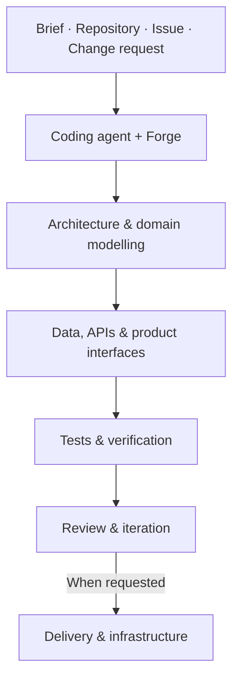

# Forge

**An engineering workflow for AI coding agents. From product intent to working software.**

[](https://www.npmjs.com/package/@teckedd-code2save/forge)
[](LICENSE)
[](https://github.com/teckedd-code2save/ai-build-tools/issues)

[Quickstart](#quickstart) · [Skills](#the-skill-ecosystem) · [Deployment](#deployment) · [Contribute](#contributing)

Forge brings reusable software engineering workflows to the coding agents you already use. Start with a product brief, an existing repository, a feature request or a bug. Forge coordinates the relevant skills and tools to design, implement, test and evolve the application, respecting your stack and project conventions.

Forge is not another coding agent or application framework. It is an open-source skill ecosystem, with a CLI that installs skills, agent instructions and MCP configuration.

## Quickstart

**Requirements:** Node.js 22.13+ on the 22.x line or 23.5+ (24 LTS recommended), npm, and a supported coding agent.

From your project directory:

```bash
npx @teckedd-code2save/forge init --project
```

Choose your agent, skills and MCP integrations. To target Codex specifically:

```bash
npx @teckedd-code2save/forge init --codex --project
npx @teckedd-code2save/forge check --project --agent codex
```

Restart your agent after setup. Complete the configuration and authentication for any MCP servers you intend to use. Then invoke the Forge skill in your agent (for example, `$forge` in Codex) and describe your goal:

> Build an inventory and order management application using .NET, PostgreSQL and React. Include customer and operator workflows, versioned migrations, API integration tests and Docker Compose. Verify the application before preparing it for deployment.

Or work on existing code:

> Inspect this repository, implement the requested feature using its existing conventions, update migrations and tests where needed, and prepare a reviewable change.

Setup does not create running infrastructure. The configuration check validates MCP entries, not live connections or credentials.

## How Forge works



Forge selects the relevant workflows instead of forcing every task through a new-project scaffold. Its engineering principles include:

- Respect the requested language, framework, database and deployment target.
- Preserve existing architecture and code when evolving a product.
- Implement the product surfaces and workflows implied by the requirements, not just a dashboard.
- Connect interfaces to real APIs and data; use explicit fixtures only for development and tests.
- Evolve schemas through versioned migrations.
- Verify installation, application startup and applicable tests; report checks that could not run.

For substantial builds, Forge starts with a concise system-design breakdown and keeps progress
visible: **Design → Build & preview → Verify → Deliver → Live checks**. Updates describe working
behavior, actual evidence, next steps and decisions. In Codex or another interactive agent, steer
the same workspace as it develops. The CLI's headless `forge generate` run retains its workspace
for continuation; its stage labels are agent reports, not independently verified readiness.

Read the [Forge skill](skills/forge/SKILL.md) for the full workflow.

## The skill ecosystem

Each skill is independently readable and can be improved or extended.

| Skill | Responsibility |
| --- | --- |
| [forge](skills/forge/SKILL.md) | Orchestrate new builds and changes to existing products |
| [cloud-solution-architect](skills/cloud-solution-architect/SKILL.md) | System architecture and cloud design |
| [frontend-data-consumer](skills/frontend-data-consumer/SKILL.md) | Typed frontend integration with backend contracts |
| [frontend-design-review](skills/frontend-design-review/SKILL.md) | Product interface quality and design review |
| [api-test-generator](skills/api-test-generator/SKILL.md) | API integration testing |
| [infrastructure-as-code-architect](skills/infrastructure-as-code-architect/SKILL.md) | Infrastructure design and Terraform/Pulumi workflows |
| [context7-mcp](skills/context7-mcp/SKILL.md) | Current framework and library documentation |
| [ship-to-vps](skills/ship-to-vps/SKILL.md) | Complete Vercel/GC delivery, CI/CD and explicit direct VPS operations |

## Supported agents

| Environment | Setup flag |
| --- | --- |
| Codex | `--codex` |
| Claude Code | `--claude` |
| Gemini CLI | `--gemini` |
| VS Code / GitHub Copilot | `--vscode` |
| Antigravity | `--antigravity` |

Agent capabilities and available tools vary. Setup installs the relevant guidance and configuration; the agent performs the work.

### CLI

Install globally if you prefer a persistent command:

```bash
npm install -g @teckedd-code2save/forge
forge init
```

| Command | Purpose |
| --- | --- |
| `forge init` | Interactive setup (alias of `setup`) |
| `forge init --project` | Configure the current repository |
| `forge init --yes` | Use detected defaults without prompts |
| `forge check` | Inspect MCP configuration |
| `forge skills list` | Discover available skills |
| `forge skills info forge` | Inspect a skill |
| `forge generate "your brief" --agent codex` | Run a configured coding agent with a product brief |

See the [CLI documentation](cli/README.md) or run `forge --help` for details. The source tree may contain improvements not yet released to npm.

## Integrations

Forge uses MCP and the agent's authorized tools where applicable.

- **Datafy:** database inspection, SQL operations and schema-aware development. Configure the actual `dbhub.toml` path and restart the MCP server after changing its configuration.
- **Context7:** framework and library documentation.
- **GitHub:** repository history, issues, pull requests and delivery workflows.
- **GroundControl:** infrastructure and deployment operations when selected.
- **Prisma, Redis and Elasticsearch:** stack-dependent data tooling and services.

These are capabilities to select according to the task, not mandatory infrastructure for every application. For Codex and other agent configuration details, see the [CLI setup documentation](cli/README.md).

## Deployment

Forge prepares deployment assets when delivery is part of the request. When the target is unspecified, it compares Vercel and GroundControl using the workload, runtime, data, existing resources and account capabilities, then offers a concrete recommendation. It respects an explicit choice. See the [workload comparison](skills/forge/references/deployment-choice.md).

- **GroundControl:** prepare application and database recipes, image delivery and operational checks for an authorized host. Updated GC servers expose `deployment.create_options`, `deployment.plan` and `deployment.create` with explicit creation-host consent. Older servers or cached connectors require an upgrade/refresh or their supported Projects UI. See the [GroundControl handoff](skills/forge/references/groundcontrol.md).
- **Vercel:** complete application delivery through supported Vercel tools/CLI and Git integration, including required managed data, migrations, configuration and live behavior. See the [Vercel workflow](skills/ship-to-vps/references/vercel.md).
- **Direct VPS:** the [ship-to-vps skill](skills/ship-to-vps/SKILL.md) covers explicitly selected SSH-managed delivery with GitHub/GHCR, routing and operational runbooks.

Both managed routes account for the complete app: backend, durable data, migrations, required workers, secrets, routing and verified behavior. A frontend URL alone is not full deployment. A successful code-generation command is not proof of application readiness or a successful deployment. Live verification and the necessary permissions remain essential.

## Contributing

Forge is built around reusable engineering knowledge. Contributions are welcome whether you write code, improve a skill, document a workflow or reproduce a failure.

**Start with [open issues](https://github.com/teckedd-code2save/ai-build-tools/issues).** Check for existing work before opening an issue or starting a larger change.

| Area | Ways to contribute |
| --- | --- |
| Skills | Improve instructions, add language or framework playbooks, and document edge cases |
| Agent support | Improve setup, detection, instruction installation and configuration handling |
| Integrations | Improve MCP workflows and document real capability boundaries |
| Reliability | Add regression tests, reproducible fixtures and verification steps |
| Documentation | Improve quickstarts, examples and contributor onboarding |

### Development setup

```bash
git clone https://github.com/teckedd-code2save/ai-build-tools.git
cd ai-build-tools/cli
npm install
npm run build
npm run typecheck
npm run lint
npm test
```

The CLI source lives in [`cli/`](cli/) and the canonical skill definitions in [`skills/`](skills/). For skill changes, include a representative agent prompt and the expected behavior. For CLI changes, add or update tests for the affected behavior.

Fork the repository, create a focused branch, and open a pull request with a description of the problem, the change and verification performed. Keep credentials out of commits and distinguish tested behavior from proposed capabilities.

## License

[MIT](LICENSE).
